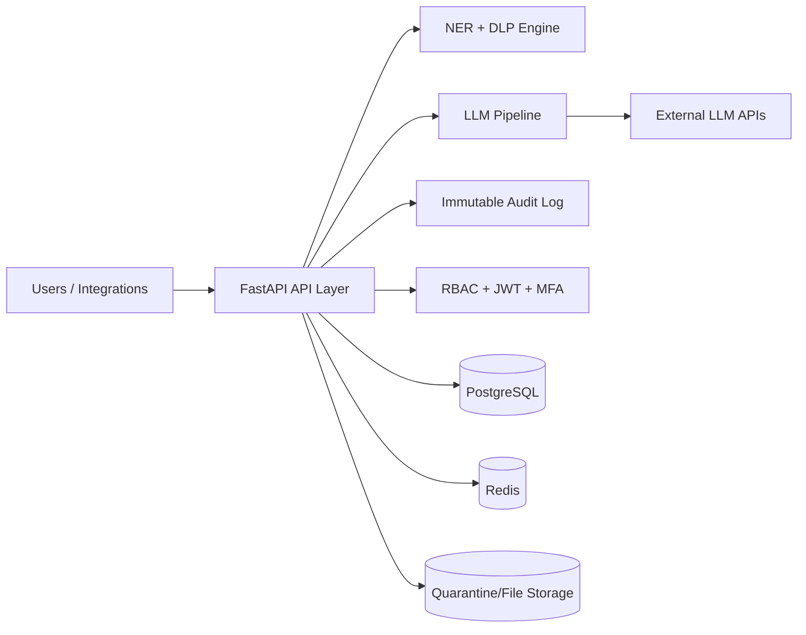

# Security Architecture

## System Graph

## Data Storage

- **PostgreSQL** stores application entities: users, scans, billing events, scheduled scans, security events, LLM interactions, and audit log entries.
- **Redis** is used for broker/cache style runtime state.
- **Quarantine/File storage** holds isolated uploaded content and flagged artifacts.
- Sensitive values are protected with encryption-at-rest helpers and KMS-backed key handling.

## Processing

- Ingress requests are authenticated (JWT), authorized (RBAC), and validated at API boundaries.
- NER + DLP rules run before sensitive content is persisted or forwarded.
- LLM pipeline performs pre/post scanning and policy checks around model interaction.
- Security actions (logins, scans, admin actions) are recorded in an immutable hash-chained audit log.

## Egress

- External model calls are routed via configurable `LLM_BASE_URL`.
- Sovereign routing support is represented by deployment configuration such as `DEPLOYMENT_REGION=PK`.
- Only policy-approved payloads are sent to external providers after pre-scan controls.

## Perimeter: What Stays vs Leaves

### Stays Inside Deployment Perimeter
- User identity/auth data
- Raw stored scan records
- Audit logs and security telemetry
- Quarantined files and local processing metadata

### May Leave Perimeter
- Model request/response payloads sent to configured external LLM endpoints through `LLM_BASE_URL`
- Explicitly configured outbound notification traffic (for example email/SMTP) when enabled

